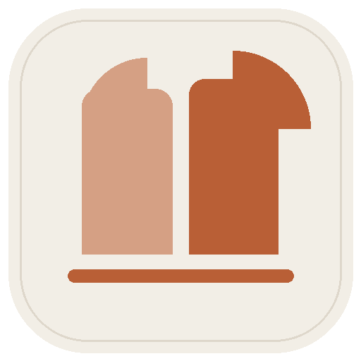
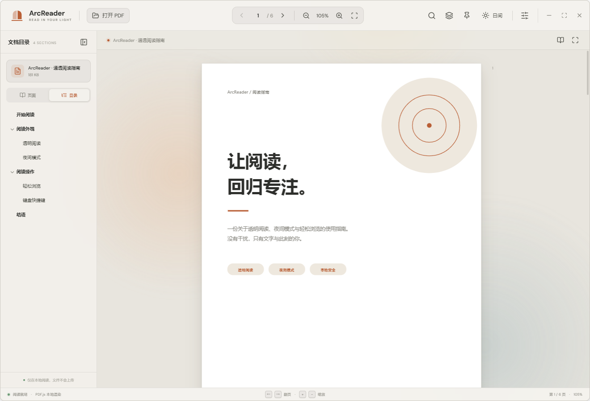
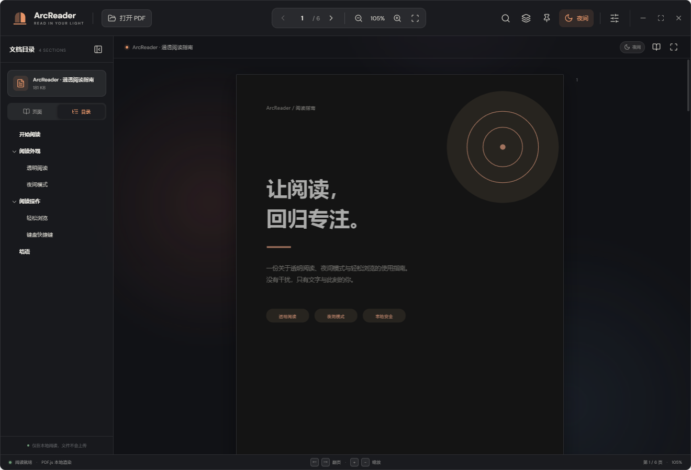
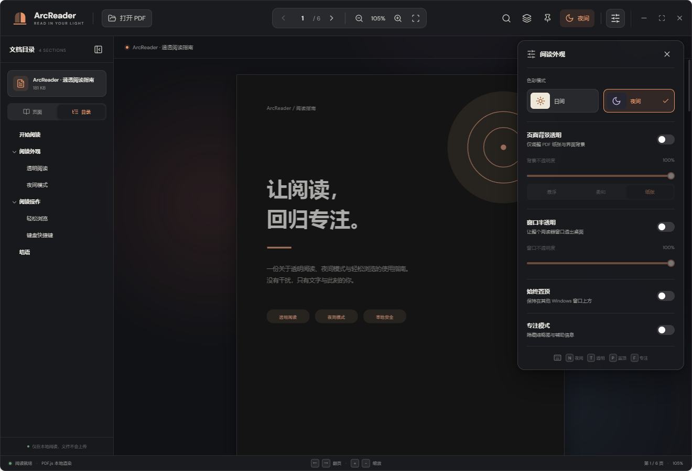

<div align="center">
  

  # ArcReader

  **通透阅读，专注当下。**

  一款本地运行的 Windows PDF 阅读器，支持 PDF 目录、窗口半透明、夜间模式和窗口始终置顶。

  [](https://github.com/DFYX233/ArcReader/releases)
  [](#安装)
  [](#技术栈)

  **[下载 Windows 安装程序](https://github.com/DFYX233/ArcReader/releases/download/v1.1.0/ArcReader-Setup.exe)** · **[查看 Release](https://github.com/DFYX233/ArcReader/releases/tag/v1.1.0)**

  
</div>

## 功能特性

### 阅读与导航

- **PDF 多级目录**：读取文档自带的书签目录，支持展开、收起和点击跳页。
- **页面缩略图**：快速浏览并定位到指定页面。
- **连续阅读**：支持滚动阅读、页码跳转、缩放和适应页面宽度。
- **全文搜索**：搜索 PDF 文字内容，并跳转到匹配页面。
- **专注与全屏**：减少辅助界面干扰，保留阅读本身。

### Windows 桌面体验

- **整个窗口半透明**：通过 Windows 原生窗口能力，让阅读器界面、文字和页面一起透出桌面，支持 35%–100% 不透明度。
- **窗口始终置顶**：一键让 ArcReader 保持在其他窗口上方，适合对照资料或边读边记。
- **双击打开 PDF**：安装后可直接双击磁盘中的 PDF 文件。
- **PDF 右键菜单**：右键 PDF，选择“使用 ArcReader 打开”。
- **独立窗口**：不需要浏览器，也不依赖 Kimi 运行。

### 个性化与隐私

- **日间 / 夜间模式**：界面、缩略图和 PDF 内容同步切换。
- **页面背景透明**：只调整 PDF 纸张和界面背景，与“整个窗口半透明”相互独立。
- **偏好自动保存**：记住夜间模式、窗口透明度和置顶状态。
- **完全本地阅读**：PDF 文件只在电脑本地处理，不会上传文档内容。

## 界面预览

### 夜间阅读



### 窗口与阅读外观设置



## 安装

### 系统要求

- Windows 10 或 Windows 11，64 位系统。
- 无需安装 Node.js 或其他运行环境。

### 安装步骤

1. 下载 **[ArcReader-Setup.exe](https://github.com/DFYX233/ArcReader/releases/download/v1.1.0/ArcReader-Setup.exe)**。
2. 双击安装程序，按照提示完成安装。
3. 通过桌面快捷方式启动 ArcReader，或直接双击一个 PDF 文件。

> 安装程序目前未进行商业代码签名。如果 Windows 显示“未知发布者”，请确认安装包来自本仓库 Release，然后选择“更多信息”→“仍要运行”。

安装程序会创建桌面和开始菜单快捷方式，并注册 PDF 文件关联及右键菜单；卸载时会清理右键菜单。

## 使用方法

### 打开 PDF

可以使用以下任意方式：

- 双击磁盘中的 PDF 文件。
- 右键 PDF，选择 **“使用 ArcReader 打开”**。
- 在 ArcReader 中点击左上角 **“打开 PDF”**。
- 将 PDF 文件拖入阅读器窗口。
- 按 **`Ctrl + O`** 打开文件选择窗口。

### 查看目录

打开 PDF 后，在左侧选择 **“目录”**。如果文档包含书签目录，可以点击条目直接跳转；如果 PDF 本身没有目录，会显示相应提示，仍可切换回“页面”使用缩略图。

### 窗口半透明与置顶

- 点击顶部**图层按钮**或按 **`T`**，切换整个窗口半透明。
- 点击顶部**图钉按钮**或按 **`P`**，切换窗口始终置顶。
- 点击顶部**外观按钮**，可精细调整窗口不透明度、页面背景透明和夜间模式。

## 快捷键

| 快捷键 | 功能 |
| --- | --- |
| `Ctrl + O` | 打开 PDF |
| `Ctrl + F` | 搜索当前文档 |
| `←` / `→` | 上一页 / 下一页 |
| `+` / `-` | 放大 / 缩小 |
| `0` | 适应页面宽度 |
| `N` | 切换日间 / 夜间模式 |
| `T` | 切换窗口半透明 |
| `P` | 切换窗口始终置顶 |
| `F` | 切换专注模式 |
| `Esc` | 关闭搜索或外观面板 |

## 从源码构建

### 环境要求

- Node.js 20 或更高版本。
- Windows 构建环境。

### 安装与运行

```bash
git clone https://github.com/DFYX233/ArcReader.git
cd ArcReader
npm install
npm run desktop
```

`npm run desktop` 会先构建前端资源，再启动 Electron 桌面窗口。

### 常用命令

```bash
# 启动网页开发服务器
npm run dev

# 构建前端资源
npm run build

# 构建并启动桌面版
npm run desktop

# 生成 Windows NSIS 安装程序
npm run build:desktop
```

安装包输出到 `release/` 目录。

> `scripts/create_sample.py` 和 `scripts/create_icon.py` 仅用于重新生成示例 PDF 与应用图标，需要 Python 以及 `reportlab`、`pypdf`、`Pillow`。正常构建不需要 Python，因为生成后的资源已经包含在仓库中。

## 项目结构

```text
ArcReader/
├── electron/           # Electron 主进程与预加载脚本
├── src/
│   ├── components/     # PDF 页面、缩略图与目录组件
│   ├── App.tsx         # 阅读器主界面
│   ├── styles.css      # 日间、夜间与透明界面样式
│   └── desktop.d.ts    # 桌面原生 API 类型
├── public/             # 示例 PDF 与站点图标
├── build/              # 应用图标与 NSIS 安装脚本
├── scripts/            # 资源生成、右键注册与验证脚本
├── docs/images/        # README 界面截图
└── package.json
```

## 技术栈

- React 19 + TypeScript
- Vite
- Electron
- PDF.js
- Lucide React
- Electron Builder / NSIS

## 隐私说明

ArcReader 不提供云端文档服务。你打开的 PDF 仅通过本地文件读取和 PDF.js 渲染，文档内容不会上传到本仓库、GitHub 或其他服务器。窗口透明度、主题和置顶等偏好仅保存在本机。

## 当前版本

**v1.1.0**：PDF 多级目录、窗口半透明、窗口始终置顶、夜间模式、PDF 双击打开和右键菜单。

完整更新与安装包请查看 **[Releases](https://github.com/DFYX233/ArcReader/releases)**。
